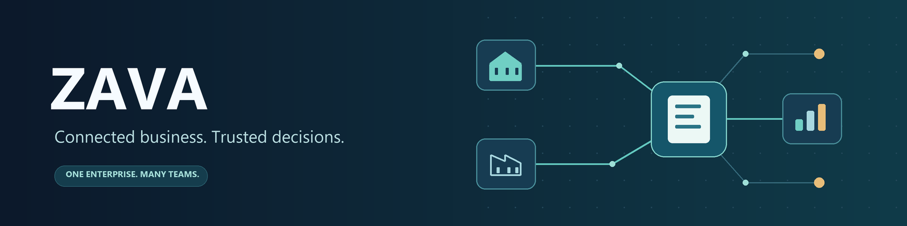

# [Microsoft Ignite 2026](https://ignite.microsoft.com)

## 🔥LAB670: Build your first Microsoft IQ Business plugin

### What is Microsoft IQ?

Microsoft IQ brings together workplace context (**Work IQ**), business data
(**Fabric IQ**) and institutional knowledge (**Foundry IQ**), alongside
**Web IQ** and connected business systems.

**Business plugins** give people a central place to curate, discover and reuse that
organizational context across agents and tools. Think of the handbooks,
policies and reporting instructions given to a new employee: *when you need
to do this business process, use these sources and follow this guidance*.
In this lab, you create that reusable context for Zava's monthly business
review, rather than paste the whole enterprise into each prompt.

The agent still reads sources you can access to produce current, grounded
output; a business plugin is neither a frozen answer nor a permission grant.

[Read the introduction](instructions/README.md#first-what-is-microsoft-iq),
then solve Zava's business challenges: start with Work IQ, add Fabric and
Foundry IQ, combine the evidence, connect business records and publish your
saved business plugins as a reusable process catalog.

### Session description

Start your workday as a business analyst at Zava. Your manager needs a monthly business review, but decisions, duplicate files, similarly named reports, semantic models and business-system records are spread across the enterprise. Curate a Microsoft IQ business plugin to organize and govern business context from data, workflows and knowledge sources, then save and reopen it and use Copilot to prepare a grounded review document. Explore how shared intelligence can be reused across Copilot, Agent 365 and custom AI applications. Change business hats and design approval-bounded processes for Zava's agent factory.

### Lab setup prerequisites

Before Mission 1, complete the **[lab setup prerequisites](instructions/lab-setup.md)**:

1. Open [Microsoft Fabric](https://app.fabric.microsoft.com) with your issued
   Skillable account, complete any first-time signup form and review/accept
   the terms yourself if authorized.
2. Confirm that the assigned workspace opens. Capacity and ScoringApp access
   must be prepared by the organizer; do not create or purchase a capacity.
3. Use the prehydrated context, or download/extract this repository and run the
   [reviewed quick setup](setup/README.md) only when instructed.
4. Verify the required source connections before starting the missions.

The quick setup targets 5-10 minutes on an already prepared environment;
cold signup, capacity provisioning and indexing may take longer.

### 🚀 Getting started

**[Start the lab →](instructions/README.md)**

The lab guide provides step-by-step instructions for the seven missions,
whether you join a guided session or work at your own pace.
Use the lab's Microsoft IQ and Copilot links and your learner account.
Prehydrated labs do not require setup scripts; run the reviewed quick setup only
when the instructor explicitly asks you to hydrate your isolated tenant.
If business sources are not available
yet, create the business plugin and guidance first, then return to context selection
and Copilot testing later.

After each business challenge, use the
[Copilot judge](instructions/zava-copilot-judge.md) for evidence-based feedback.
Improve a source choice or guidance rule, then retry the same question.
Finish with six process business plugins and a saved Zava Agent Factory catalog.

#### In a guided session

1. Complete [prerequisites](instructions/lab-setup.md), then open the lab links and find the lab workspace.
2. Choose a learner prefix so your business plugins are easy to find.
3. Follow Missions 1–7; ask the instructor if a workspace or source is missing.

#### On your own

1. Use Microsoft IQ and Copilot with sources you can access.
2. Follow the [mission board](instructions/README.md#your-mission-board).
3. Use judge feedback to improve your business plugins, then try an optional business journey.

#### Lab agenda

| Mission | Business challenge |
|---|---|
| [1: Work IQ](instructions/README.md#mission-1-decode-the-request-with-work-iq) | Decode Avery's request and separate decisions from opinions |
| [2: Fabric IQ](instructions/README.md#mission-2-find-the-right-numbers-with-fabric-iq) | Find the right models and reconcile the KPI evidence |
| [3: Foundry IQ](instructions/README.md#mission-3-resolve-the-policy-with-foundry-iq) | Resolve current policy and required review |
| [4: Combined IQ](instructions/README.md#mission-4-combine-work-fabric-and-foundry-iq) | Build the decision-ready MBR |
| [5: Work IQ + Salesforce](instructions/README.md#mission-5-check-commitments-with-work-iq-and-salesforce) | Check commitments before an Operations handoff |
| [6: IQ + business connectors](instructions/README.md#mission-6-investigate-recovery-with-iq-and-business-connectors) | Investigate recovery without inventing cause or task state |
| [7: Agent factory](instructions/README.md#mission-7-publish-your-zava-agent-factory) | Save the process catalog and demonstrate a reviewed handoff |

Allow about 90 minutes for the missions, judging and debrief, plus a separate
5-10-minute setup target on an already prepared environment. Cold signup,
capacity provisioning and indexing can take longer. The quick profile includes
three authoritative models, not the full report/connector/optional-scenario corpus.

### 🎯 Learning outcomes

By the end of this session, you will be able to:

- Create reusable business plugins for business processes with current sources and clear guidance.
- Use Copilot to compare cited answers and prepare an internal document or read-only app draft, if supported.
- Improve drafts with Copilot-judge feedback and connect saved business plugins through reviewed evidence handoffs.

### One company, multiple business processes

Zava's teams share one enterprise but answer different business questions.
Customer and supplier records use anonymous identifiers in this fictional story.

[Persona scenarios](instructions/zava-scenarios.md) and
[business-process recipes](instructions/zava-business-plugins.md) cover MBR,
supply chain, recognition, sales, service, procurement and data stewardship.
Each recipe has a specific source set, curation decisions, prompt, draft
deliverable and human-approval boundary.

For processes beyond the MBR, the
[connected business journeys](instructions/zava-agent-factory.md) start from
sales commitments, campaign opportunities or incidents and integrate
fulfillment, procurement, Finance, policy, launch and customer-review work.
The guide provides Copilot prompts, evidence briefs and checks for each handoff.
Start with two connected steps and keep the output as an internal draft.

### 💻 Technologies used

- **Microsoft IQ** — create and reuse business plugins for business processes.
- **Work IQ, Web IQ, Fabric IQ and Foundry IQ** — workplace, web, analytical and institutional context.
- **Salesforce, Asana, ServiceNow and Azure DevOps** — business records relevant to the selected scenarios.
- **Copilot** — test the business plugins and prepare internal business drafts.

### 📚 Continue your learning

Pick your next step based on your learning style:

| Resource | What you'll get |
|----------|-----------------|
| **[Ignite 2026 Next Steps](https://aka.ms/ignite26-next-steps)** | Additional session repos and materials from Microsoft Ignite 2026 |
| **[Microsoft AI Skills Navigator](https://aka.ms/ignite26-asn)** | Discover AI skills, learning paths, and resources for your next step |
| **[Microsoft Learn](https://aka.ms/ignite26-learn)** | Official documentation and guided learning paths on these topics |
| **[Microsoft Foundry Community](https://aka.ms/MicrosoftFoundryDiscord-Ignite26)** | Connect with other learners and experts in our Discord community |

### 👥 Content owners

<table>
<tr>
    <td align="center"><a href="https://github.com/santhoshravindran7">
         
        <b>Santhosh Kumar Ravindran</b></a> 
            <a href="https://github.com/santhoshravindran7" title="talk">📢</a>
    </td>
</tr></table>

Santhosh Kumar Ravindran ([@santhoshravindran7](https://github.com/santhoshravindran7)).

### ⚖️ Trademarks

This project may contain trademarks or logos for projects, products, or services. Authorized use of Microsoft trademarks or logos is subject to and must follow [Microsoft's Trademark & Brand Guidelines](https://www.microsoft.com/legal/intellectualproperty/trademarks/usage/general). Use of Microsoft trademarks or logos in modified versions of this project must not cause confusion or imply Microsoft sponsorship.

Any use of third-party trademarks or logos are subject to those third-party's policies.
