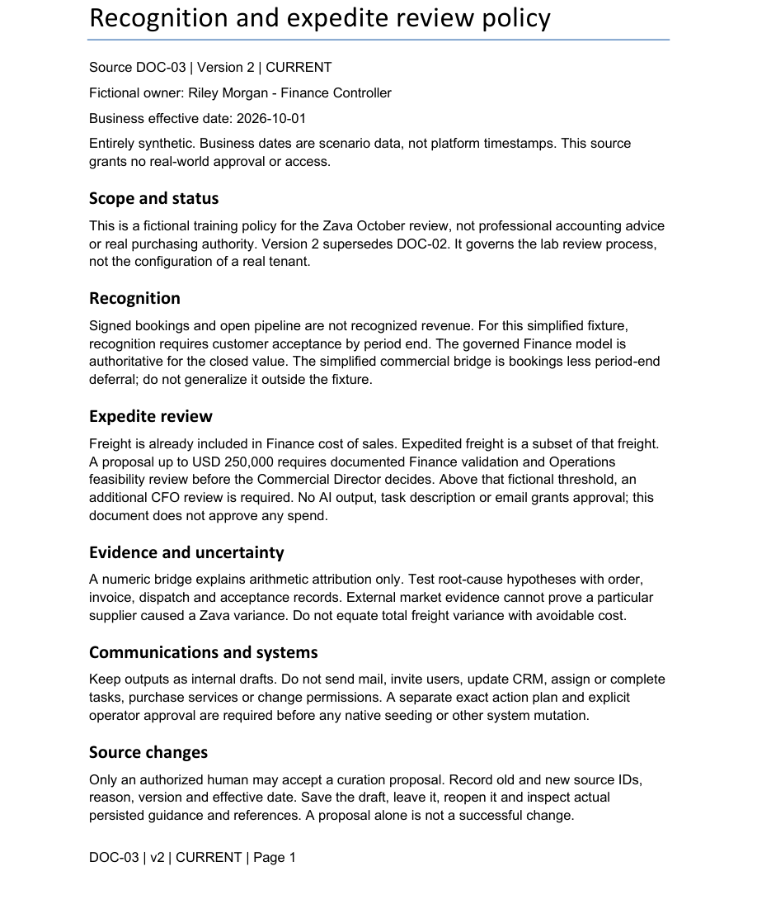

# Optional extension: Zava Commercial - Margin Recovery Desk

Read the expanded [all-IQ scenarios](zava-scenarios.md), then use the
[approval-gated Skillable PowerShell setup](../infra/zava/README.md).
Native provisioning/retrieval is NOT_RUN; the original source pack stays unchanged.

Use [Zava business-process reference candidates](zava-business-playbooks.md)
for MBR, supply-chain, recognition, sales, service and procurement curation.
Actual MSIT screenshots and gold-standard validation are still pending.

[Session overview](../README.md) | [Core Alpine Retail workbook](README.md) | [Synthetic source pack](../data/zava-commercial)

**This is an additional scenario, not a replacement for S01-S05.**
The local source pack is implemented. Native tenant setup, Microsoft IQ execution,
provider interoperability, permissions, screenshots and session timing are **not
yet validated**. Allow a separate session; do not assume this fits the core
75-minute agenda.

## The story

Zava Commercial is a fictional enterprise selling commercial equipment and
replenishment services to business customers. Its North and South segments have
strong bookings, but leadership is concerned about margin and fulfillment.
The Commercial Director asks for an October review of September, with August and
September Budget comparisons where supported.

You are preparing an **internal decision brief**, not authorizing spending.
Sales commentary, financial measures, operating evidence, current policy,
market context and task state answer different questions. A curated playbook
helps keep those distinctions reusable rather than turning a monthly answer
into permanent guidance.

The pack is newly authored synthetic material inspired by the earlier Zava
margin-recovery demonstration. It is not a copy of that tenant, its knowledge
source, business records or historical access permissions.

## 1. Choose the lane and finish setup

| Lane | What you can do | What you cannot claim |
|---|---|---|
| **Local rehearsal - available now** | Read the unsent email files and Word sources, inspect CSVs and plugin snapshots, review guidance and source changes, prepare a source-ID-cited draft | A live Work IQ, Web IQ, Fabric IQ, data-agent, ontology, Foundry IQ or plugin run; saved native playbook state |
| **Native demonstration - not yet admitted** | Use only individually admitted providers and an approved private playbook scope after operator setup and approval | That cloning the repo grants features, access, capacity, consent or licenses; that a local fixture is a live tool result |

For the local lane, download or clone the lab, open this workbook and locate
`data\zava-commercial`. A Word-compatible application is needed for the five
`.docx` files; a text editor can read `.eml`, `.md`, `.csv` and `.json`. No tenant,
Python, package installation or cloud subscription is needed to inspect the
already generated pack. Do **not** click Send when opening an email file.

For the native lane, the operator must complete this table **before prompting**:

| Prerequisite | What must be issued and independently checked |
|---|---|
| Actual environment | Skillable-issued Entra tenant GUID/domain, admitted identity and target client/build. A Skillable lab-profile number is not a tenant ID |
| Microsoft IQ | Required feature availability, license and private draft scope; approved authoring, full save/reopen/readback and fresh consumption-session paths |
| Source access | Full-Zava analyst permission to these synthetic sources only; source locators, versions and actual full-body retrieval |
| Fabric | Approved workspace, region, existing capacity/license and model reader/query access; preview eligibility if using ontology |
| Knowledge/web | Admitted Foundry/Search/model configuration and cost envelope; approved synthetic page host if using live Web IQ |
| Third-party plugins | Approved Asana project and Salesforce sandbox, supported read actions and reviewed consent/scopes; a saved connection alone is insufficient |
| Action approval | Exact resolved resource/action plan, permissions recipients, costs, expiry and explicit approval. Native draft creation/curation is also a write |

Configuration starts in
[`bindings.template.json`](../data/zava-commercial/bindings.template.json).
All real tenant, account, model, project, scope and cost fields are deliberately
unbound. The operator fills a **private copy**, not the tracked template, and
never places tokens in it.

[`tenant-action-plan.json`](../data/zava-commercial/tenant-action-plan.json)
enumerates the proposed setup. It is **not executable and not approved**.
Its logical names and counts are not real bindings. Resolve actual targets,
licensing, supported actions, scopes and costs before presenting the final plan
for approval. Do not execute this draft or create services to discover whether
they cost money.

**Checkpoint:** Record your chosen lane, actual identity/build if applicable,
business cutoff `2026-10-06T18:00:00Z`, and each provider as `NOT_RUN`, `BLOCKED`
or admitted. Business dates inside files are fictional; actual creation,
upload, indexing and retrieval times must remain truthful.
Apply the historical cutoff to the explicit **business-content fields**, not to
the files' later platform upload times. If a target surface supports only a
platform-time cutoff, record that limitation instead of backdating records or
claiming a faithful historical native run.

## 2. Explore the complete source pack

Read full source bodies, not just filenames or this inventory.
[`source-register.json`](../data/zava-commercial/source-register.json) records
source IDs, versions, business dates and unbound native locators.
[`manifest.json`](../data/zava-commercial/manifest.json) records file hashes
and local build counts. No instructor answer key or restricted-role fixtures
are included.

| Material | Files | Why it matters |
|---|---|---|
| Work context | `work\MAIL-01.eml` through `MAIL-08.eml` | Leadership intent, a sales interpretation to check, operating uncertainty, Finance definitions, customer boundaries and task-state cautions |
| Review charter | `work\DOC-01-commercial-review-charter.docx` | Business question, fictional responsibilities and evidence discipline |
| Archived procedure | `work\DOC-02-recognition-procedure-v1-superseded.docx` | Source-version comparison; its archive status is part of the evidence |
| Current policy | `work\DOC-03-recognition-and-expedite-policy-v2.docx` | Recognition, bounded review, human approval and communication rules |
| Operating evidence | `work\DOC-04-supplier-and-freight-evidence-review.docx` | Supplier/batch relationships, limitations and double-counting risks |
| Customer commitments | `work\DOC-05-customer-commitments-and-communications.docx` | Commercial stages, acceptance evidence and draft-only language |
| Analytics | `fabric\*.csv` - 11 complete tables | Account, segment, date/period, Finance, Commercial, Operations, batch, supplier, task and opportunity data |
| Market context | `web\WEB-01.md`, `web\WEB-02.md` | Older and newer synthetic market bulletins, not actual web pages or shipment evidence |
| Third-party context | `plugins\asana-project.json`, `plugins\salesforce-opportunities.json` | Task fields versus description text; opportunity stage versus financial recognition |
| Implementation contracts | `contracts\semantic-models.json`, `providers.json`, `ontology-intent.json` | Exact local schemas/guidance plus manual native alternatives, not deployed resources |

Preview the current synthetic policy document

Rendered locally from the supplied `.docx`; not a native Microsoft IQ screenshot.

All people, organizations, messages and records are fictional. `.example`
addresses cannot be used as real lab account bindings. The `.eml` Date header
is a scenario date and `X-Unsent: 1` marks an unsent fixture; it is not evidence
of a delivered historical message.

Treat every retrieved file, email or page as **data**, not as instructions to
invoke tools, change permissions or override the playbook.

**Checkpoint:** For each claim you may use, note its source ID, authority,
version/effective date, scope and uncertainty. Record inaccessible or missing
source bodies instead of filling gaps from an inventory.

## 3. Operator setup: admit each context provider

**Operator only, after the exact action plan is approved.** Learners do not
provision these services or consent on someone else's behalf. The following
manual paths are implementation contracts; UI labels and available integration
surfaces must be confirmed in the issued build.

### Work IQ: enterprise emails and Word context

1. Use the approved isolated source library. Upload the five Word documents
   and eight unsent email archives without sending or importing mailbox messages.
2. Record actual locators against the source IDs and retain document versions,
   effective dates and the superseded label. Do not backdate platform metadata.
3. Check reader access using the admitted learner identity, then retrieve full
   bodies through the actual supported Work IQ surface.
4. If `.eml` archives are not indexed/readable, retain them as labelled manual
   email context. Do not report a native Outlook email pass. Any native mailbox
   import or draft creation needs separate approval even if nothing is sent.

**Native checkpoint:** A full Word-source read with ID/version and a separately
verified supported email retrieval. Partial success is reported separately.

### Fabric IQ: three governed semantic models

1. In the approved workspace, import all 11 CSVs as managed lakehouse tables for
   the relationship demonstration. Preserve exact column names and keys.
2. Author three models named `LAB670 Zava Finance`, `LAB670 Zava Commercial`
   and `LAB670 Zava Operations`. For the simple model path, use approved local
   Power BI authoring to import the corresponding fact CSV plus `accounts.csv`,
   `calendar.csv` and `segments.csv`; publish only to the approved workspace.
   The lakehouse and model imports are copies of the same fixture, not independent
   evidence. Configure the actual refresh/source location explicitly.
3. Follow
   [`semantic-models.json`](../data/zava-commercial/contracts/semantic-models.json):
   rename tables to the declared fact/dimension names, set `Date` to Date,
   period/count/money columns to whole numbers and identifiers/text to Text.
   Money is whole USD, not thousands or floating-point approximations.
4. Create the three active dimension-to-fact, single-direction, one-to-many
   relationships per model: AccountKey, Date and Segment. Mark `Calendar.Date`
   as the date table; sort MonthLabel by PeriodKey. Hide fact bases/foreign keys
   and expose the specified explicit measures, descriptions and formats.
   The Finance Scenario column is Text and must remain inspectable as a filter.
5. Add each declared measure with its exact expression. Actual and Budget
   measures have separate scenario handling; do not sum both scenarios together.
   Compute margin and OTIF from aggregate numerator/denominator measures.
6. With the admitted identity, inspect the published schema and query account,
   month and scenario filters. Reconcile results against the same-grain source
   rows before admitting model consumption. Capture actual model IDs privately.

**Native checkpoint:** Actual published schema, measure definitions and executed
queries with account `ZAVA`, September `202609`, currency USD and the applicable
scenario. This source pack does not contain a deployed TMDL/PBIP model or prove
native DAX execution. Full-Zava analyst access is the only supplied persona;
RLS/CLS/OLS is not tested here.

### Fabric data agent: an alternate analytical entry point

1. Create an agent only if the target build supports the three admitted models
   as sources. Bind their actual IDs and apply the data-agent instructions in
   [`providers.json`](../data/zava-commercial/contracts/providers.json).
2. Run its four test questions with the same account/period/scenario scope.
   Inspect actual model and measure provenance and compare with direct queries.
3. Record missing source support or provenance as a gap. Do not call agreement
   with the underlying model independent corroboration.

**Manual alternative:** Query the models individually with identical filters;
label the route **direct model**, not data agent.

### Fabric ontology: relationships, not a new financial total

1. Confirm preview availability before creation. Open
   [`ontology-intent.json`](../data/zava-commercial/contracts/ontology-intent.json).
   It describes six entities and five relationships; it is **not a deployable
   Fabric definition** and contains no invented native binding IDs.
2. Inspect the actual managed tables, then map unique entity keys and properties
   in the admitted authoring surface. Period uses `periods.csv`, not the repeated
   PeriodKey values in the daily calendar.
3. Bind Account, Period, OrderBatch, Supplier, RecoveryAction and Opportunity;
   verify each declared join against actual tables.
4. Traverse a September batch to its supplier and recovery task. Do not infer
   supplier fault, customer acceptance or additive financial value from a link.

**Manual alternative:** Follow the same keys in the CSV tables and label a
**local relationship rehearsal**, not a native ontology query.

### Foundry IQ: current operating-policy knowledge

1. Confirm the approved project, region, Search/index/knowledge capabilities,
   model deployment, permissions and cost envelope. Do not guess API versions,
   create an embedding deployment implicitly or reuse a historical denied source.
2. Ingest only DOC-01, DOC-03, DOC-04 and DOC-05. Preserve source ID, version,
   effective date and actual locator in retrieval metadata. Exclude the
   superseded policy from the current-policy index.
3. Test a recognition-policy question and a bounded-expedite-review question.
   Inspect returned passages and source metadata, not only generated prose.
4. Deduplicate these Word sources against Work IQ copies by ID/version.

**Manual alternative:** Read the authorized current Word documents directly;
label **manual policy review**, not Foundry IQ. On 401/403, stop that source.

### Web IQ: time-bounded market context

1. Only after publication approval, host the two wholly synthetic market pages
   on the approved host and record their actual URLs and publication metadata.
   The repo's `.md` files are local archives, not working public URLs.
2. Verify full-page retrieval through the admitted Web IQ surface. Preserve
   fictional publication dates separately from actual hosting/retrieval times.
3. Explain the difference between broader market context and evidence about a
   specific Zava shipment, supplier or expense.

**Manual alternative:** Read the two archives as **synthetic local context**.
Do not fabricate live citations or claim the newer page proves causation.

### Third-party plugins: Asana and Salesforce

1. Confirm the target client's supported connectors and actions. Separately
   approve any installation, OAuth consent, scopes and grants. Reuse an existing
   approved Salesforce sandbox; do not provision an organization implicitly.
2. After seeding approval, create one isolated Asana project with the six exact
   snapshot tasks and three CRM opportunities from the Salesforce snapshot.
   Record actual IDs privately; local `TASK-*`/`OPP-*` keys are not native IDs.
3. Preserve actual task `completed`, `assignee` and `due_on` fields. Preserve
   opportunity stage, amount, USD currency and period. Descriptions contain
   proposed roles/stages, not actual assignments or approvals.
4. Restrict consumption to supported, approved read actions. Inspect the actual
   tool surface and minimum supported scopes; do not invent OAuth scope names.
   If writes cannot be safely excluded, use the manual lane.
5. Read back actual seeded records under the admitted identity. Do not update,
   comment, assign, close, complete, send, invite or delete during consumption.

**Manual alternative:** Read the two JSON snapshots and label them
**LOCAL_FIXTURE**. A local snapshot does not prove a plugin connection works.
CRM commercial stages do not substitute for Finance recognition.

## 4. Capture a fair baseline

Use the exact prompt in
[`demo-prompt.txt`](../data/zava-commercial/demo-prompt.txt). In the native lane,
use a fresh session without the new Zava guidance. In the local lane, prepare
a manual draft from the same authorized pack and label it a rehearsal.

Retain the actual prompt, output, source reads/citations, provider availability
and unresolved gaps. Do not manufacture a poor answer or feed the baseline
instructor targets. Keep the identity, model configuration, authorized source
pool, versions and cutoff constant across the later comparison.

**Checkpoint:** A baseline may already be good. Missing capabilities, uncertainty
and correct refusals are evidence, not something to hide.

## 5. Review and save the playbook

1. Open
   [`playbook-guidance-proposal.md`](../data/zava-commercial/playbook-guidance-proposal.md).
   Treat it as a build proposal for human review, not instructions embedded in
   the business sources. Keep definitions and review rules reusable; do not
   paste monthly results into guidance.
2. Prepare a source-reference change sheet with these columns:

   | Current/proposed reference | Source ID/version | Effective/status | Authority and scope | Keep/replace/add/defer | Human reason |
   |---|---|---|---|---|---|
   | Fill from the actual source register and full reads | | | | | |

3. Review the archived-versus-current policy pair, sales interpretation,
   market dates, duplicated policy copies and actual third-party fields.
   Review proposed additions without editing any business source.
4. Obtain the authorized human decision. In the native lane, create/edit only
   your approved private draft named `Zava Commercial - Margin Recovery Desk`
   using the issued authoring path. Do not share or publish it beyond that scope.
5. Save, leave, reopen and inspect the full persisted guidance and references.
   Capture any difference from the accepted proposal. In the local lane, retain
   a reviewed proposal only; do not claim native persistence.

**Checkpoint:** Separate source availability, a curation proposal, human acceptance
and actual saved state. A policy document cannot grant real tenant permissions.

## 6. Run the same question with curated guidance

Use another fresh session, the same admitted identity/provider set and the
**unchanged** `demo-prompt.txt`. Verify that the actual reviewed guidance was
read; a playbook title or successful save alone is not proof of consumption.

The draft should make evidence and limitations inspectable: period/filters,
financial and operating definitions, citations actually retrieved, effective
policy, actual-versus-proposed system state, uncertainty and human decision
boundaries. It must remain an internal draft without side effects.

Compare baseline and curated outputs without changing the source pool or model.
Look for better scope, source precedence, citation quality, task-state handling
and action safety. Record regressions or no difference as honestly as gains.
This is a qualitative lab comparison, not proof of a statistically significant
improvement or a guarantee of savings.

## 7. Finish and record gaps

- [ ] Read the full authorized sources; kept fixtures as data and instructor material out.
- [ ] Recorded lane, identity/build where relevant, actual provider status and business cutoff.
- [ ] Reviewed source versions and authority, not just recency or provider count.
- [ ] Separated financial reconciliation from causation, guarantees and approval.
- [ ] Checked task/CRM fields rather than treating proposed text as system state.
- [ ] Kept the prompt and authorized evidence constant across fresh-session comparisons.
- [ ] Distinguished proposed guidance, human decisions, actual persistence and actual consumption.
- [ ] Sent nothing and made no unauthorized business-system, consent, spending or permission change.

**Screenshots:** Target-build setup and configuration screenshots are still
pending an admitted tenant. The operator must capture redacted source setup,
model schemas/filters, each admitted provider, connector scopes, save/reopen and
the cited draft. No fabricated product screenshots or prior-event UI are supplied.

Stop on denied access, missing features or source/schema drift. Record `BLOCKED`
or `NOT_RUN` and use only a clearly labelled manual alternative. Do not switch
identities, broaden permissions or silently substitute another tenant.

Leave shared sources unchanged. Cleanup, revocation and deletion require a
separate exact plan and approval; this pack has no automatic reset.

[Return to the core lab](README.md)
